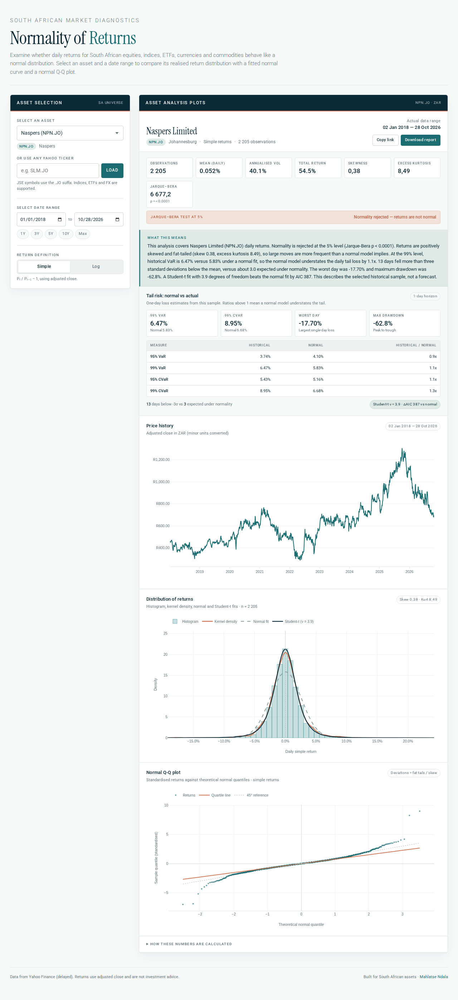

# SA Normality of Returns

[](https://github.com/alexndala/sa-normality/actions/workflows/ci.yml)

Interactive distribution and tail-risk diagnostics for South African assets.
Built for JSE equities, indices, ETFs, bonds, ZAR FX and commodities.



## What it does

Select an asset and date range, then inspect:

1. **Price history** — adjusted closing price in ZAR (or USD for global assets).
2. **Distribution of returns** — histogram, Gaussian kernel density, normal fit
   and Student-t fit.
3. **Normal Q-Q plot** — standardised returns against theoretical normal
   quantiles with a quartile reference line.
4. **Tail-risk panel** — historical and normal-implied 95%/99% VaR and CVaR,
   worst day, maximum drawdown, and 2σ/3σ exceedances.
5. **Plain-English verdict** — what the skew, kurtosis, Jarque-Bera result and
   tail gap mean for this sample.

The app also generates a **two-page PDF report** with all charts, diagnostics and
methodology. See a [sample report](docs/sample-report.pdf).

Every analysis is shareable through the URL, for example:

```text
/?symbol=STXGOV.JO&start=2020-01-01&end=2024-12-31&type=log
```

## Stack

- Next.js 14 (App Router, TypeScript)
- Plotly (`plotly.js-basic-dist-min`, loaded on the client)
- `jsPDF` for client-side reports
- Yahoo Finance chart endpoint, proxied through `/api/analyze`
- Vitest for the statistics unit tests

## Local development

```bash
npm install
npm run dev
```

Open <http://localhost:3000>.

```bash
npm test        # statistics unit tests
npm run lint
npm run build
npm start
```

`npm start` serves the standard production build. The Docker image sets
`BUILD_STANDALONE=1`, which enables Next.js standalone output for the container.

## Asset universe

The curated list lives in `src/lib/assets.ts`:

- JSE indices: All Share, Top 40, Top 40 USD Net TRI
- JSE equities: Naspers, Prosus, banks, insurers, miners, retailers, property
- SA ETFs and bonds: Satrix 40, Capped All Share, sector ETFs, property,
  SA Bond (`STXGOV.JO`), ILBI (`STXILB.JO`), MSCI World, EM, Nasdaq 100,
  TRACI, NewGold
- ZAR FX pairs
- Commodities priced in USD
- Crypto

Any other Yahoo Finance ticker can be loaded through the custom ticker field.
JSE symbols generally use the `.JO` suffix (for example `NPN.JO`).

## API

`GET /api/analyze?symbol=NPN.JO&start=2018-01-01&end=2026-10-28&returnType=simple`

- `symbol`: Yahoo Finance ticker (case-insensitive)
- `start`, `end`: `YYYY-MM-DD`
- `returnType`: `simple` or `log`

The response includes the price series, diagnostics, risk metrics, normal and
Student-t fits, histogram/KDE curves, Q-Q data and the generated narrative.
Responses are cached in memory for 15 minutes.

`GET /api/health` returns a health payload for Railway.

## Methodology

- Prices: adjusted close, with JSE `ZAc` (cents) converted to ZAR.
- Returns: `simple` (`Pₜ/Pₜ₋₁ − 1`) by default, or `log` (`ln(Pₜ/Pₜ₋₁)`).
- Annualised volatility: sample standard deviation × √252.
- Skewness: third standardised moment.
- Excess kurtosis: fourth standardised moment − 3.
- Jarque–Bera: `n/6 × (S² + K²/4)`, p-value `exp(−JB/2)` (χ² with 2 df).
- VaR/CVaR: 1-day historical estimates; normal estimates use the sample mean
  and standard deviation. Ratios compare historical with normal.
- Exceedances: actual days below `μ − 2σ` and `μ − 3σ` versus normal expectation.
- Student-t: maximum-likelihood fit over `(μ, σ, ν)`, with a moment
  approximation if optimisation fails. AIC compares the normal and t fits.
- KDE: Gaussian kernel, Silverman's rule of thumb
  `0.9 × σ × n^(−1/5)`.
- Q-Q: plotting positions `(i − 0.5)/n`; quartile line through the 25th and
  75th percentiles (equivalent to R's `qqline`).

## Deployment (Railway)

The repo includes a multi-stage `Dockerfile` and `railway.toml`:

```bash
railway up
```

Set `SITE_URL` to the public URL so Open Graph metadata resolves correctly.
On Railway, `RAILWAY_PUBLIC_DOMAIN` is used automatically when the variable is
absent. `NEXT_PUBLIC_SITE_URL` is also accepted for compatibility.

The container listens on `PORT` (default `3000`) and exposes `/api/health`.
`next.config.js` uses `output: 'standalone'` when `BUILD_STANDALONE=1` is set
during the Docker build.

## Project structure

```text
src/lib/risk.ts        VaR/CVaR, drawdown, exceedances
src/lib/studentT.ts    Student-t density and MLE fit
src/lib/narrative.ts   plain-English verdict builder
src/lib/report.ts      two-page PDF report
src/lib/share.ts       URL state validation
src/components/        selection, charts, risk panel, report actions
src/app/api/analyze/   Yahoo proxy and analytics endpoint
```

## Limitations

- Yahoo Finance is an unofficial, delayed data source and may rate-limit
  requests from cloud IPs. The API caches responses and retries `query2` after
  `query1`, but occasional failures are possible.
- Tail metrics are 1-day, in-sample estimates. They describe the selected
  sample, not a forecast.
- Some SA series, such as `STXILB.JO`, can contain extreme price prints. The
  distribution chart clips a Student-t peak when it would otherwise make the
  histogram unreadable.
- The normality tests and risk metrics are not investment advice.

## Roadmap

- JSE normality screener with a nightly snapshot
- Rolling 60/120/250-day skew, kurtosis and Jarque-Bera diagnostics
- SA event annotations (COVID, July 2021 unrest, elections, load shedding)
- Compare mode for two or three assets
- Portfolio-level distribution builder
